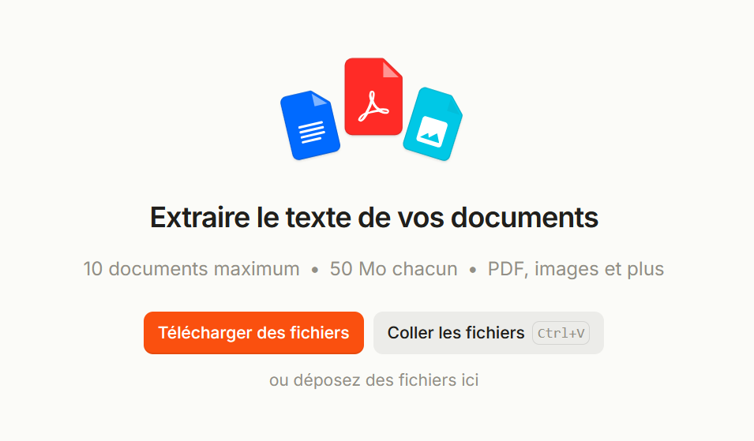
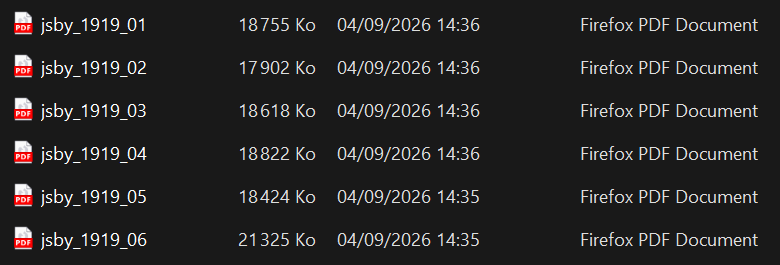
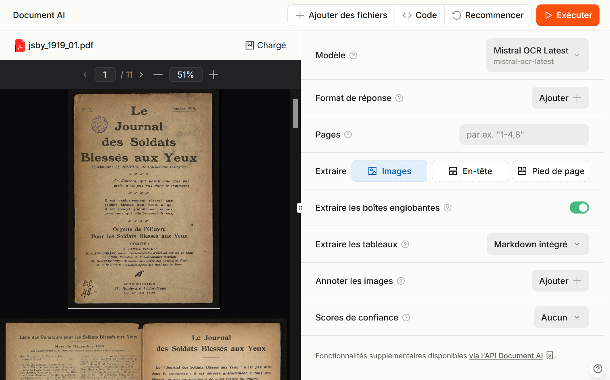
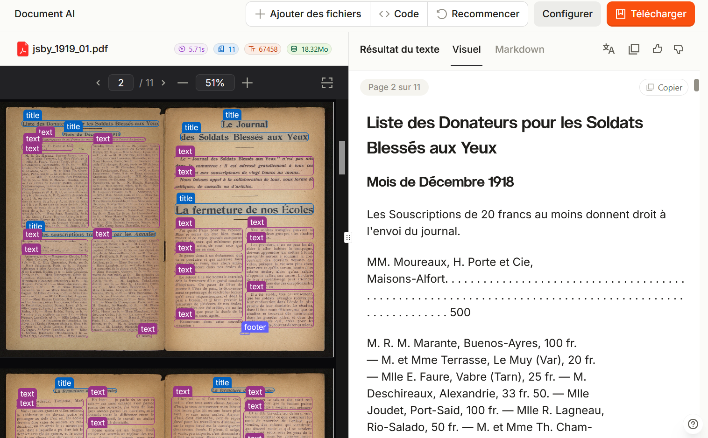

**Le processus d’océrisation**

1. *L’utilisation de Mistral OCR avec le AI Studio*

Mistral AI est une entreprise française spécialisée dans l’intelligence artificielle générative. Parmi les fonctionnalités proposées, elle offre Mistral OCR qui est “conçu pour extraire le texte et les images intégrées d’un large éventail de documents“ ([https\://mistral.ai/fr/news/mistral-ocr-3/](https://mistral.ai/fr/news/mistral-ocr-3/)) et qui permet aujourd’ui de prendre “en charge 170 langues dans 10 groupes linguistiques” ([https\://mistral.ai/fr/news/ocr-4/](https://mistral.ai/fr/news/ocr-4/)).  
Cela peut être utilisé avec le Studio AI, qui est une plateforme permettant de créer, déployer et gérer des systèmes d'IA autonome ([https\://mistral.ai/fr/products/studio/](https://mistral.ai/fr/products/studio/)).  
A partir du AI Studio ([https\://console.mistral.ai/](https://console.mistral.ai/)) et de l’option “Document AI” de **Créer**, il est donc possible d’opérer une transcription gratuite des fonds, à condition d’avoir des fichiers d’une taille raisonnable (moins de 50 Mo chacun) et pas trop nombreux (10 fichiers maximum).  

*Page d’accueil de ‘Document AI’ sur AI Studio*

2. *L’ajout de PDFs sur AI Studio et le choix des options pour l’océrisation*

A partir des fichiers PDF des fonds des aveugles de guerre, soit le *Journal des Soldats Blessées aux Yeux*, *Pour le Foyer du Soldat Aveugle* et le *Bulletin de l’Union des Aveugles de Guerre et du Journal des Soldats Blessées aux Yeux*, qui faisaient pour la majorité moins de 25 Mo, donc ils étaient compatibles avec les limites de Mistral OCR.  
 
*Taille moyenne des fichiers du* Journal des Soldats Blessés aux Yeux

Une fois les fichiers chargés dans AI Studio, on opère aux choix des fonctionnalités, qui sont pour la plupart les mêmes que ceux proposés par défaut sur le site, excepté pour l’option “Images” dans **Extraire** qui n’a pas besoin d’être sélectionné, car ce n’est pas essentiel pour la sortie dont on a besoin. Une fois tout choisi, il suffit d’appuyer sur le bouton **Exécuter**.  

*Affichage des documents une fois chargé sur AI Studio*

3. *Les résultats de la transcription après océrisation*

Après exécution, AI Studio sortira une transcription des fonds, qui, s’aidant d’une segmentation qui reconnaît les zones de texte et apprend à différencier entre texte, titre, liste, etc., sera au format markdown avec la conservation des différents types d’éléments présents dans le texte.  

*Figure : La zonification de la segmentation et la sortie markdown de la transcription*

4. *Le téléchargement des résultats*

Une fois les fichiers obtenus, il est possible de récupérer le tout, en appuyant sur **Télécharger**. Cela générera un dossier ZIP contenant un dossier pour chaque fichier PDF qui avait été envoyé. Dedans se trouve un fichier markdown contenant toutes les pages concaténées les unes après les autres, ainsi qu’un dossier “pages” avec dedans un dossier pour chacune des pages du PDF et sa sortie markdown et ses métadonnées. Afin de pouvoir exploiter correctement les fichiers, il est préférable de renommer le fichier markdown nommé “markdown” par le nom du PDF, soit du dossier dans lequel il se trouve. Ensuite, un script ([retrieve\_documents.py](http://tei_transformation/scripts/retrieval_scripts/retrieve_documents.py)) appelant les dossiers de markdown permettra de récupérer ces documents dans un même dossier, afin de les encoder en une fois.