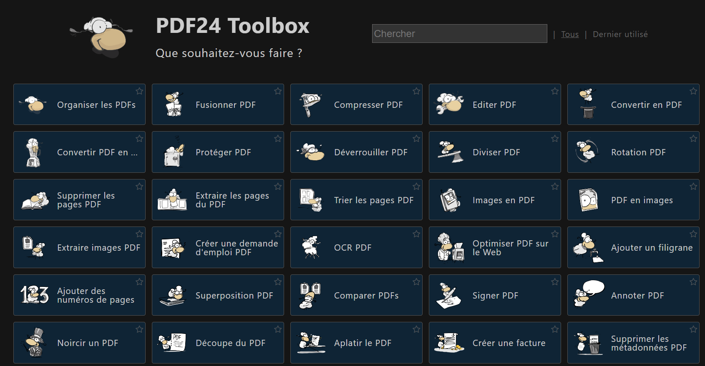
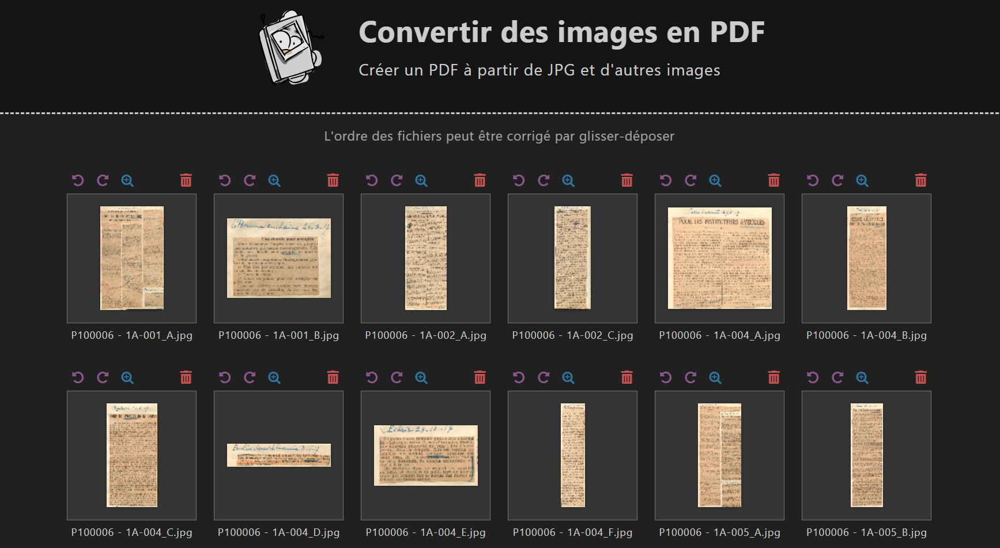
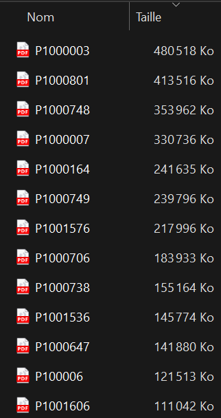
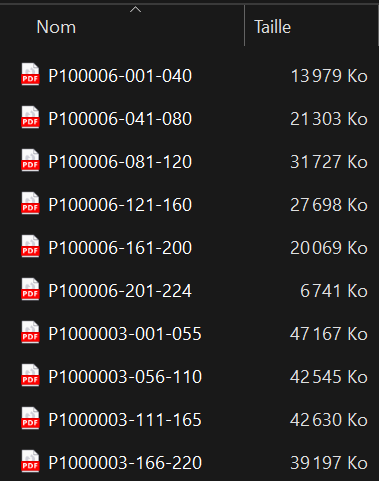
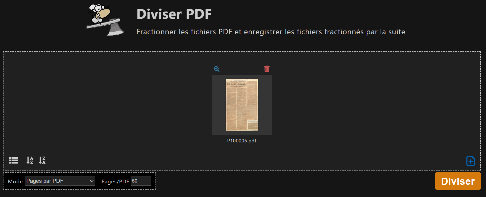
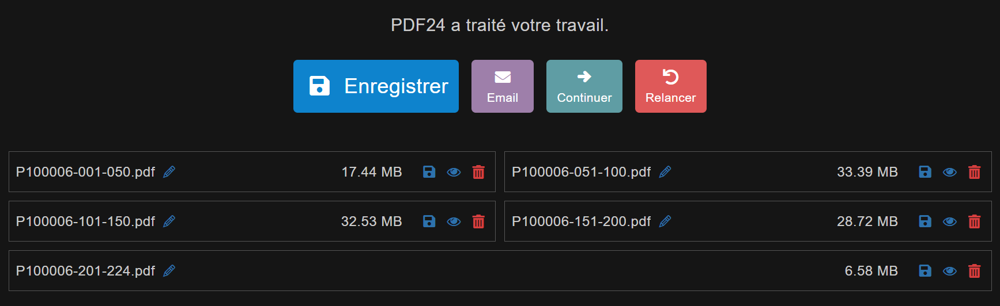
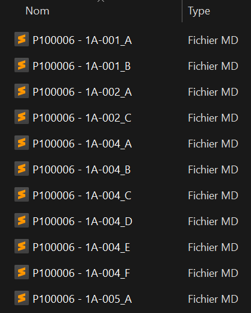
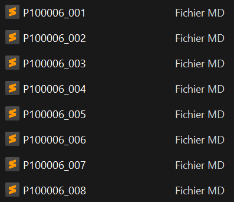

**Le processus de traitement des fichiers de coupure de presse**

1. *Préparer les documents pour leur océrisation*

Les fichiers de coupures de presse des volumes déjà numérisés sont actuellement tous disponibles sur le Sharepoint. Une fois les milliers d’images récupérées, celles-ci sont réparties par dossier faisant référence à leur nom de dossier à la racine, probablement le nom du volume d’où elles sont tirées (P100006, P1000007, P1000164, etc.). A partir de ces images, nous créons un fichier PDF pour chacun des dossiers. Pour ce faire, nous utilisons PDF24 ([https\://www\.pdf24.org/fr/](https://www.pdf24.org/fr/)), disponible dans une version locale qui permet de faire un certain nombre de tâches, dont la transformation d’images en PDF. 

*Tâches proposées avec PDF24*

 
*Tâche “Images en PDF”*

Nous obtenons ainsi 20 PDF qui font entre 30 et 480 Mo. Si les plus petits volumes sont adéquats pour un traitement dans le AI Studio de Mistral, les plus gros ne le sont pas et il est donc nécessaire de les diviser en plusieurs parties, afin de pouvoir tous les traiter convenablement. Une fois la division effectuée, nous obtenons 106 PDF, dont les tailles varient entre 3 et 49 Mo. L’outil permet d’ailleurs de connaître la taille de chacun des fichiers une fois divisé, ce qui signifie qu’il est toujours possible de changer le nombre de pages pour chacun si le fichier est trop lourd, ou au contraire, peut encore être agrandi.  

 
*Fichiers PDF avant et après la division en plus petites parts*

*Tâche “Diviser PDF”*

*Résultats à exporter après application de la tâche de divisions*

L’étape consistera donc à océriser tous ces documents, par le biais du AI Studio et de Mistral OCR (voir la partie “Le processus d’océrisation” pour plus de détails). Le travail se fera 10 documents à la fois, puisqu’il n’est pas possible d’en mettre plus via le Studio. Cela nécessitera donc de faire la démarche 11 fois, au regard du nombre de documents. Une fois chacun des envois exécutés et terminés, nous téléchargeons le tout, que l’on extrait du ZIP pour le mettre dans un dossier unique. A partir de cela, nous passerons à l’étape suivante qui consistera à récupérer les noms d’origine des fichiers d’images pour en renommer les markdowns.

2. *Récupérer les informations d’origine des documents*

Dans les dossiers de sorties fournies par Mistral OCR, on peut trouver plusieurs types de documents : 

- directement dans le dossier, un fichier markdown contenant tout le contenu du PDF concaténé  
- dans le dossier “pages” du dossier principal, on trouve plusieurs dossiers, soit un pour chaque page du PDF  
- dans un dossier “page-XX” du dossier “pages”, on trouve le fichier markdown de la page, ainsi qu’un JSON contenant des métadonnées, et les images de l’image lorsque certaines ont été repérées pendant l’océrisation.

Lors de l’océrisation des revues, on récupérait le markdown concaténé, puisque le PDF formait un tout réel. Dans le cas de nos documents ici, le PDF a été créé afin de permettre de faire un travail de grande envergure. Ainsi, ce sont les markdown uniques dans les dossiers de page que l’on va vouloir récupérer, et pour ce faire, il est nécessaire de les renommer, car ils sont actuellement appelés “markdown” dans chacun des dossiers, sans aucune distinction, ce qui n’est pas pratique, notamment car on va vouloir les rassembler dans un même dossier, ce qui créera des problèmes.  
Afin de les renommer d’une manière pratique, nous avons créé un script Python (renamed\_files\_in\_folder.py) qui a pour vocation de lire un dossier de dossier, d’aller y chercher les fichiers markdown trouvés dans ces dossiers, et de les renommer de la manière suivante : 

| python3 scripts/modifying\_scripts/renamed\_files\_in\_folder.py markdown/P100006-001-040.pdf/pages/ 1 P100006 python3 scripts/modifying\_scripts/renamed\_files\_in\_folder.py markdown/P100006-041-080.pdf/pages/ 41 P100006 python3 scripts/modifying\_scripts/renamed\_files\_in\_folder.py markdown/P100006-081-120.pdf/pages/ 81 P100006 |
| :---: |

Exemple de lignes dans l’invite de commande pour le renommage des markdown avec le nom de dossier

Les argument de la ligne de commande sont les suivants : 

- Appel du script  
- Appel des dossiers où se trouve les fichiers markdown de la sortie Mistral OCR  
- Nombre de départ pour la numérotation des fichiers (en accord avec le numéro de départ du PDF)  
- Nom de la racine du dossier d’images

Une fois cette transformation faite, nous allons récupérer tous ces fichiers Markdown dans un même dossier, afin de pouvoir par la suite lancer le processus d’encodage, par le biais du script *retrieve\_documents.py*. Cependant, si les documents sont bien nommés dans l’ordre du PDF dont ils sont récupérés, ils ne correspondent pas aux noms des fichiers d’images dont ils sont issus. Nous allons ainsi mettre en place une transformation, par le biais de la ligne de commande, des noms de fichiers en utilisant les éléments suivants : 

- “mv” qui permet de renommer des fichiers en ligne de commande  
- nom du fichier actuel  
- nouveau nom du fichier, avec des signes spécifiques à ajouter pour prendre en compte les espaces qui figurent dans les noms de fichiers d’origine

| mv P100006\_001.md P100006\\ \-\\ 1A-001\_A.md mv P100006\_002.md P100006\\ \-\\ 1A-001\_B.md mv P100006\_003.md P100006\\ \-\\ 1A-002\_A.md mv P100006\_004.md P100006\\ \-\\ 1A-002\_C.md |
| :---- |

Exemple de lignes dans l’invite de commande pour le renommage des fichiers selon le nom des images

*Nommage des fichiers Markdown d’océrisation avant et après*

Une fois ces transformations faites, il sera alors possible de lancer le processus d’encodage.