# Le processus d’encodage

## 1. Les formats de fichiers

Dans le cadre de ce travail d’encodage, on retrouve plusieurs extensions, et donc formats, de fichiers, qui ont chacun leur propre intérêt. Les fichiers d’entrée sont soit des markdown (.md), soit des json (.json), et les fichiers de sortie sont des XML-TEI (.xml).

Le markdown est un *“langage de balisage léger que vous pouvez utiliser pour ajouter des éléments de mise en forme à des documents en texte brut*” ([https\://www\.markdownguide.org/getting-started/](https://www.markdownguide.org/getting-started/)). Dans le cadre du markdown, l’utilité est d’“*intégrer une syntaxe spécifique au texte pour indiquer quels mots ou expressions doivent faire l’objet d’une mise en forme particulière*”.   
Dans le cadre de cet encodage, le markdown est l’extension obtenue en sortie du processus d’océrisation, qui est fait par le biais de Mistral OCR. On retrouvera donc, au départ, la transcription des documents du fonds “Aveugles de guerre” sous ce format.

Le JSON est un *“format léger d'échange de données, totalement indépendant du langage. Il est facile à lire et à écrire pour les humains, et simple à analyser et à générer pour les machines. Il repose sur deux structures : une collection de paires “nom/valeur” et une liste ordonnée de valeurs*” ([https\://www\.json.org/json-en.html](https://www.json.org/json-en.html)). Dans le cadre de cet encodage, le JSON a été utilisé pour collecter les métadonnées créées durant le catalogage des fonds ou extrapolées par l’intelligence artificielle durant le processus d’océrisation des documents. 

La XML-TEI est un “*langage de balisage permettant de représenter les caractéristiques structurelles, de rendu et conceptuelles de textes*”, qui est aujourd’hui considéré comme un standard dans la représentation informatique des textes en sciences humaines et sociales ([https\://tei-c.org/](https://tei-c.org/)). La TEI se compose notamment d’un très grand nombre de balises et attributs, que l’on peut retrouver par hiérarchie, thématiques ou autres, dans les TEI Guidelines ([https\://tei-c.org/release/doc/tei-p5-doc/en/html/index.html](https://tei-c.org/release/doc/tei-p5-doc/en/html/index.html)). Suivant cela, l’encodage se fait exclusivement avec des balises et attributs que l’on retrouve dans la documentation. Les choix variés étant faits entre l’une ou l’autre des balises disponibles sont sauvegardés et documentés dans un fichier dédié qui se nomme l’ODD.

## 2. Les scripts et fichiers de variable

Le processus d’encodage se fait de manière semi-automatique à l’aide de scripts écrits en Python, un langage de programmation, contenant une multitude de bibliothèques et de modules, permettant de faire de nombreuses manipulations ([https://docs.python.org/3/tutorial/index.html](https://docs.python.org/3/tutorial/index.html)). Ces scripts sont appelés dans l’invite de commande (ou terminal), avec des arguments déterminés dans le script même (notamment les dossiers d’entrée et de sortie).

Dans le cadre de ce processus, on utilise trois types de fichiers Python: 

- des scripts de récupération, qui vont permettre d’obtenir soit des documents, soit des données variées  
- des scripts d’encodage, qui vont permettre de passer d’un point A à un point B entre les documents, jusqu’à obtenir la version finale qui sera utilisée pour les étapes suivantes  
- des fichiers de variable, rattachés aux scripts d’encodage, qui permet de récupérer certains types d’informations, afin de les implémenter dans l’encodage du document

### 1. Les scripts de récupération

Le script *retrieve\_documents.py* récupère, dans un dossier donné, contenant lui-même des sous-dossiers, tous les documents avec la même extension. Cette extension est elle-même donnée en 4ème et dernier argument dans la ligne de commande. Les documents récupérés sont ensuite copiés dans un dossier donné en comme 3ème argument.

```
python retrieve_documents.py <dossier_source> <dossier_destination> <file_ending> 
```
*Exemple de la ligne de commande pour l’exécution de ce script*

Le script *retrieve\_regex.py* récupère, dans un dossier donné de fichiers XML-TEI, les extraits de fichiers qui comportent des expressions régulières, soit des chaînes de caractères qui décrivent, selon une syntaxe précise, un ensemble de chaînes de caractères possibles, données dans un dictionnaire. Ces expressions régulières sont inscrites dans un fichier Python créé et nommé directement avec le script, dans le dossier à partir duquel le terminal est situé pour exécuter la ligne de commande.

```
python retrieve_regex.py <dossier_source>
```
*Exemple de la ligne de commande pour l’exécution de ce script*

Le script *retrieve\_metadata.py* récupère, dans un dossier donné de fichiers XML-TEI, les métadonnées suivantes : le nom, le titre et la date du fichier. Une fois récupérés, ils sont inscrits dans un fichier CSV créé et nommé directement avec le script, dans le dossier à partir duquel le terminal est situé pour exécuter la ligne de commande.

```
python retrieve_metadata.py <dossier_source>
```

*Exemple de la ligne de commande pour l’exécution de ce script*

| Filename | Title | Date |
| :---- | :---- | :---- |
| 12108.xml | Bulletin mensuel de l'Union des aveugles de guerre et Journal des soldats blessés aux yeux \- 2ème année 1920, n°4 | 01/04/1920 |
| 12133.xml | Bulletin mensuel de l'Union des aveugles de guerre et Journal des soldats blessés aux yeux \- 3ème année 1921, n°11 | 01/11/1921 |
| 12136.xml | Bulletin mensuel de l'Union des aveugles de guerre et Journal des soldats blessés aux yeux \- 3ème année 1921, n°12 | 01/12/1921 |

*Extrait de la sortie CSV du script* retrieve\_metadata.py

Le script *retrieve\_tags\_attributes.py* récupère, dans un dossier donné de fichiers XML-TEI, les balises TEI. Pour chacune de ces balises, le script mentionne s’il a un ou plusieurs attributs, et lorsque c’est le cas, les diverses valeurs de l’attribut sont données. De plus, un comptage est effectué pour chacune des balises, des attributs et des valeurs, mentionnant le nombre de fois où apparaît chacun des éléments. Ce script est divisé en deux sorties : la recherche dans \<teiheader\>, soit les métadonnées, ou dans \<text\>, soit le corps du texte. Une fois récupérés, ils sont inscrits dans un fichier de texte brut créé et nommé directement avec le script, dans le dossier à partir duquel le terminal est situé pour exécuter la ligne de commande.

```
python retrieve_tags_attributes.py <dossier_source> teiHeader|text
```
*Exemple de la ligne de commande pour l’exécution de ce script*

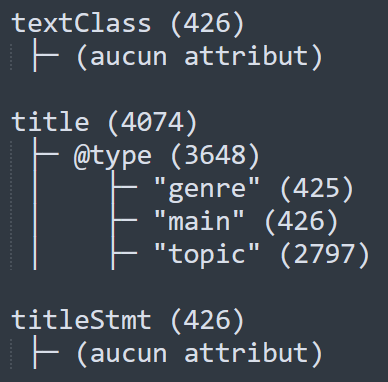
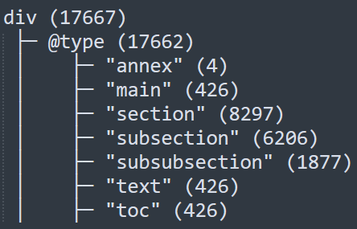

*Extraits de la sortie pour les métadonnées (\<textClass\>, \<title\>, \<titleStmt\>) et le corps du texte (\<div\>)*

### 2. Les scripts d’encodage

Le script *convert\_md\_to\_tei.py* lit un dossier donné de fichiers en markdown, et traite également les json, s’il y en a dans le dossier. La structure markdown est adaptée au balisage en XML-TEI, tel que les éléments commençant par un ou plusieurs hashtags (\#) deviennent des balises \<head\> ou une suite d’éléments commençant par un tiret devient une \<list\>. En plus, de nouvelles métadonnées sont ajoutées, à l’aide de variables appelées dans le préambule, notamment par le fichier *variables.py*. Une fois tout cela pris en compte, les fichiers nouvellement créés sont ajoutés dans un dossier donné en dernier argument. Ceux-ci auront le même nom que dans le dossier d’entrée, avec seulement l’extension changeant de .md à .xml.

```
python convert_md_to_tei.py <dossier_source> <dossier_destination>
```
*Exemple de la ligne de commande pour l’exécution de ce script*

Le script *additional\_modifications.py* lit, dans un dossier donné de fichiers XML-TEI, tous les documents et apporte des modifications aux cas suivants : 

- Les revues ont généralement une page de garde récurrente, dont la structure d’encodage a été décidée à l’avance. A l’aide d’une variable, celle-ci est ajoutée  
- Dans certains cas, avec le changement de page et la création des balises \<pb\>\<note/\> pour le signaler, un paragraphe est fermé puis ouvert, alors que la phrase continue d’une page à l’autre. En utilisant certains éléments de texte pour reconnaître cela, ces ajouts de balises fermantes puis ouvrantes sont supprimés.  
- Une transcription par OCR peut créer un certain nombre d’espaces superflus, qui représentent juste du vide dans le texte. A l’aide d’une fonction, ces espaces sont nettoyés. 

Une fois ces modifications faites, les fichiers modifiés sont créés et ajoutés dans un dossier donné en dernier argument.

```
python additional_modifications.py <dossier_source> <dossier_destination>
```
*Exemple de la ligne de commande pour l’exécution de ce script*

Le script *correct\_regex.py* lit, dans un dossier donné de fichiers XML-TEI, tous les documents et cherchent les cas où certaines expressions régulières et leurs corrections, inscrites dans un dictionnaire Python, appelé à partir du fichier de variable Python *regex.py*, apparaissent dans les fichiers. Une fois les corrections faites, en changeant la clé du dictionnaire par sa valeur, la nouvelle version des fichiers est insérée dans un dossier appelé en dernier argument. En parallèle, les modifications faites pendant ce processus sont inscrites dans un fichier de texte brut créé et nommé directement avec le script, dans le dossier à partir duquel le terminal est situé pour exécuter la ligne de commande.

```
python correct_regex.py <dossier_source> <dossier_destination>
```
*Exemple de la ligne de commande pour l’exécution de ce script*

Le script *create\_toc.py* lit, dans un dossier donné de fichiers XML-TEI, tous les documents et apporte des modifications aux cas suivants : 

- Lorsqu’il trouve un groupe de textes \<p\> avec des titres \<head\> en début à chaque fois, il entoure le tout d’une balise \<div\>. Lorsque deux \<head\> se suivent, cela est pris en compte comme une hiérarchie et les \<div\> et leur type de section sont ajoutés en conséquence  
- Lorsqu’une date se trouve dans la balise \<date\> en tant que chaîne de caractères, sous la forme “Avril 1919” ou “01/04/1919”, cette date sera normalisé pour être mis dans la balise @when sous la forme “1919-04-01”, pour que cela soit conforme aux règles de balisage de TEI  
- Certains éléments de pieds de page, comme notamment le gérant et la maison d’imprimerie responsable de la publication de la revue est souvent mentionné à la fin des documents. Une fonction de ce script permet de baliser correctement cette information avec la balise \<fw\>.  
- La modification finale, et la plus importante, est faite une fois tous ces changements effectués : la création d’une table des matières, dans une \<div @type=”toc”\>, avant la \<div\> contenant le texte. Cette table des matières présente sous la forme d’une liste imbriquée, tous les \<div\> avec un type de section, et y fait un renvoi, à l’aide de la présence de @xml:id dans les \<div\> et de @target dans les \<item\> de la \<list\>.

Une fois les modifications faites, la nouvelle version des fichiers est insérée dans un dossier appelé en dernier argument, avec une nouvelle balise \<change\> dans le \<revisionDesc\>, afin d’indiquer ce qui a été modifié avec l’exécution de ce script.

```
python create_toc.py <dossier_source> <dossier_destination>
```
*Exemple de la ligne de commande pour l’exécution de ce script*

Le script *adding\_metadata\_TEI.py* s’utilise dans le cas où, lors du début du processus d’encodage, le dossier markdown/ ne contenait aucun JSON, signifiant donc que les métadonnées principales attendues n’ont pas été ajoutées. Ce script a donc pour but de remédier à cette situation, et d’ajouter notamment les éléments suivants :  \<abstract\>, \<keywords\>, \<term\> et \<classCode\>. Il lit, dans un fichier JSON, certains types de métadonnées, et dans un dossier donné de fichiers XML-TEI, tous les documents. Une fois les informations récupérées et les modifications faites, la nouvelle version des fichiers est insérée dans un dossier appelé en dernier argument, avec une nouvelle balise \<change\> dans le \<revisionDesc\>, afin d’indiquer ce qui a été modifié avec l’exécution de ce script.

```
python adding_metadata_TEI.py <fichier_json> <dossier_source> <dossier_destination>
```
*Exemple de la ligne de commande pour l’exécution de ce script*

Le script *replace\_div.py* lit, dans un dossier donné de fichiers XML-TEI, tous les documents et cherchent les cas où des divisions \<div\> sont imbriquées les unes dans les autres, sans titre \<head\> entre les deux, résultat d’une erreur étant créé parfois lors de l’application des scripts successifs d’encodage. Une fois les corrections faites, la nouvelle version des fichiers est insérée dans un dossier créé et nommé directement avec le script. En parallèle, les cas de divisions changés pendant ce processus sont inscrits dans un fichier de texte brut créé et nommé directement avec le script, dans le dossier à partir duquel le terminal est situé pour exécuter la ligne de commande.

```
python replace_div.py <dossier_source>
```
*Exemple de la ligne de commande pour l’exécution de ce script*

### 3. Les fichiers de variables

Le fichier *functions.py* contient la majorité des fonctions utilisés dans les scripts du processus d’encodage, tels que la mise en place de la table des matières (*build\_toc\_from\_node*, *build\_hierarchical\_toc*), la conversion de certaines structures markdown en balisage TEI (*markdown\_to\_html*, *text\_enrichment*), l’insertion de la pagination et de la foliation (*add\_breakno\_pb*, *insert\_foliation*), le groupement des \<head\> entre eux pour faire une \<div\> (*group\_head\_with\_content*, *group\_head\_with\_subdivs*, *group\_all\_heads*) ou encore la création des mots-clés dans les métadonnées (*slugify*).

Le fichier *metadata\_json.py* contient la fonction *inject\_metadata* qui cherche, dans le fichier JSON du même nom que le markdown traité, en fonction de la hiérarchie spécifique de ce type de fichier, les données suivantes : le type du document, les mots clés et sujets (qui peuvent être multiples), le titre principal, le résumé, la classification Dewey, la date du document, son format et les droits qui lui sont attachés.

Le fichier *variables.py* contient les informations génériques de métadonnées à mettre dans le \<teiHeader\> tels que \<projectDesc\>, \<respStmt\>, \<sourceDesc\>, \<encodingDesc\> et \<seriesStmt\>, ce dernier changeant en fonction de la revue travaillée (Bulletin de l’UAG et du Journal des Soldats Blessés aux Yeux, Pour le Foyer du Soldat Aveugle, etc.). Ce fichier de variable contient également la structure encodée récurrente de la page de garde de la revue traité, appelé dans le script *additional\_modifications.py*, afin de ne pas avoir à refaire le même encodage récurrent à chaque fichier traité.

Le fichier *regex.py* contient une grande diversité d’expressions régulières, qui seront appelées lors de l'exécution du script *correct\_regex.py*. Elles peuvent avoir pour but de corriger la présence de signes mathématiques, ajoutées d’une certaine manière avec le markdown mais non transformés durant la conversion en XML-TEI, les successions de barres obliques inversées (\\\\) qui avaient pour but d’échapper des caractères qui ont cependant disparus lors de la conversion et qui sont donc ici ajoutés à nouveau, ou encore la transformation d’exposants comme Dr, Me ou 2e, dans une manière homogène pour le langage de balisage TEI (\<hi rend=”superscript”\>).

## 3. Le déroulement du processus

Afin de mieux comprendre le fonctionnement du déroulé du processus, les lignes de commande seront données avec les noms de dossiers qui ont été utilisés localement lors de l’exécution des scripts. Les dossiers qui ont été utilisés durant le processus sont les suivants: 

- Le dossier *markdown/* contient les fichiers de transcription en markdown et les métadonnées en JSON  
- Le dossier *tei/* contient les fichiers XML qui sont produits après la première étape de conversion  
- Le dossier *final/* contient les fichiers XML qui sont produits après la dernière étape de conversion, qui met en place de la table des matières  
- Le dossier *renamed/* contient une copie des fichiers XML, qui sont ensuite renommés  
- Le dossier *faits/* contient les fichiers des dossiers *markdown*/, *final/* et *renamed/* une fois le travail fini, afin de passer à une nouvelle salve de traitement du corpus  
- Les dossiers *scripts/encoding\_scripts/*, *scripts/modifying\_scripts/* et *scripts/retrieval\_scripts/* contiennent les divers scripts utilisés, triés en fonctione de ce qu’ils font durant le processus (encodage, modification ou récupération)

Pour le déroulé du processus, l’invite de commande se trouvera toujours dans un dossier qui contient tous ces divers dossiers. Si une ligne de commande se fait depuis un autre dossier, l’information est donnée.

### 1. Le point de départ : les fichiers de transcription

Afin de pouvoir commencer l’encodage du fonds “Aveugles de guerre”, il est nécessaire de récupérer les transcriptions obtenues après le processus d’océrisation. Ces fichiers sont disponibles au format markdown, et sont généralement placés dans des sous-dossiers d’un dossier d’OCR, chaque sous-dossier faisant référence au document océrisé. Cependant, le processus d’encodage est un processus fonctionnant par lot, donc il est nécessaire de récupérer les documents dans un même dossier, pour les traiter aisément. Dans certains cas, le sous-dossier contient également les métadonnées au format JSON, nommé ainsi “XXX\_metadata.json”, que l’on veut également récupérer afin d’encoder ces informations en parallèle.   
Afin de récupérer ces documents, nous allons utiliser le script *retrieve\_documents.py* et mettre les fichiers dans un dossier *markdown/*.

```
python scripts/retrieval_scripts/retrieve_documents.py ../OCR/ markdown/
```
*Ligne dans l’invite de commande pour récupérer les fichiers*

Une fois ces documents récupérés, il est nécessaire, si des fichiers JSON ont également été récupérés, de les renommer, afin de que leur nom soit exactement le même que leur fichier markdown correspondant, puisque le script de conversion fonctionne ainsi pour pouvoir traiter les deux en même temps.  
Pour faire ce renommage, il est nécessaire de se placer dans le dossier *markdown/*, et d’exécuter ensuite la commande ‘mv’ suivi de l’ancien puis du nouveau nom du fichier, ce qui va permettre de le renommer.

```
mv 12124_metadata.json 12124.json 
mv 12125_metadata.json 12125.json 
mv 12126_metadata.json 12126.json 
mv 12127_metadata.json 12127.json
```
*Exemple de lignes dans l’invite de commande pour le renommage des fichiers selon le nom des markdown*

### 2. La première étape de conversion : du markdown à la XML-TEI

Maintenant que les fichiers ont été récupérés et sont tous dans un même dossier, il est possible de commencer le processus d’encodage.  
Celui-ci commence tout d’abord par une première étape de conversion, qui exécute trois scripts consécutivement, afin d’obtenir une première version des fichiers XML-TEI, qui devront être corrigés manuellement sur certains points, afin de passer à l’étape suivante.  
Pendant cette étape sont donc exécutés le script *convert\_md\_to\_tei.py*, qui convertit la structure des fichiers markdown en une structure HTML pour ensuite en faire un XML TEI propre, tout en ajoutant des informations au \<teiHeader\> qui comprend les métadonnées. Ensuite, ces fichiers sont modifiés, avec *additional\_modifications.py* pour corriger quelques erreurs qui ont pu être faits durant l’exécution du 1er script, mais qui ne peuvent pas se régler dans le script-même, ainsi qu’ajouter des éléments qui doivent être mis une fois la conversion complète. Enfin, le dernier script *correct\_regex.py* a pour but de corriger ce qu’on peut considérer comme des restes de markdown, qui n’auraient pas été transformés lors de la conversion, notamment des signes mathématiques. Ce travail se fait à l’aide d’un dictionnaire d’expressions régulières et leurs corrections, qui peut être complété si besoin.

```
python scripts/encoding_scripts/convert_md_to_tei.py markdown/ tei/ 
python scripts/encoding_scripts/additional_modifications.py tei/ tei/ 
python scripts/encoding_scripts/correct_regex.py tei/ tei/
```
*Lignes dans l’invite de commande pour exécuter les scripts de conversion en XML-TEI*

Si les scripts sont exécutés consécutivement, ils n’ont pas tous les mêmes dossiers d’entrée et de sortie. Le premier script a, comme dossier d’entrée, le dossier *markdown/*, contenant les fichiers markdown (et JSON) et, comme dossier de sortie, le dossier *tei/* qui est vide avant l’exécution de ce script. Ensuite, les deux scripts suivants ont le même dossier d’entrée et de sortie, à savoir le dossier *tei/*, ce qui signifie que lors de ce processus, les fichiers sont réécrits dans les deux cas. Ainsi, s’il y a eu une erreur pendant le processus, il faudra exécuter à nouveau les trois scripts ensemble, afin d’obtenir la bonne version de base pour l’exécution des deuxième et troisième scripts.

### 3. La première relecture manuelle : corrections de certaines erreurs récurrentes

La relecture des premiers fichiers XML-TEI encodés durant le processus ont permis d’éclairer un certain nombre d’erreurs récurrentes, qui doivent être réglées avant de passer à l’étape suivante de conversion. Afin de garantir une correction optimale des fichiers XML-TEI, celle-ci est faite avec le document source au format PDF visible en parallèle.

Tout d’abord, comme cela a été mentionné lors de la présentation des scripts utilisés, durant l’étape de conversion, la page de garde récurrente de la revue traitée est ajoutée, afin de garder l’encodage spécial décidé en amont. Cela implique donc qu’il faut modifier deux choses : 

- Le bout d’encodage ajouté est un *template* donc il ne contient pas les informations clés de la page de garde, à savoir l’année et le numéro de la revue, ainsi que la date de publication. Il faut donc les rajouter, en utilisant le titre du fichier ou la transcription présente plus bas qui contient cette information.  
- La transcription en elle-même contenait déjà cette page de garde puisqu’elle avait été océrisé, et cette partie aura donc été encodée de manière basique. Il est donc nécessaire de supprimer tout ce pan d’encodage, qui n’est pas correct et ferait doublon de texte.

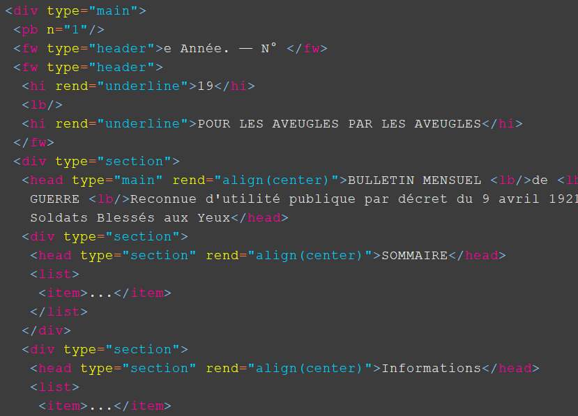
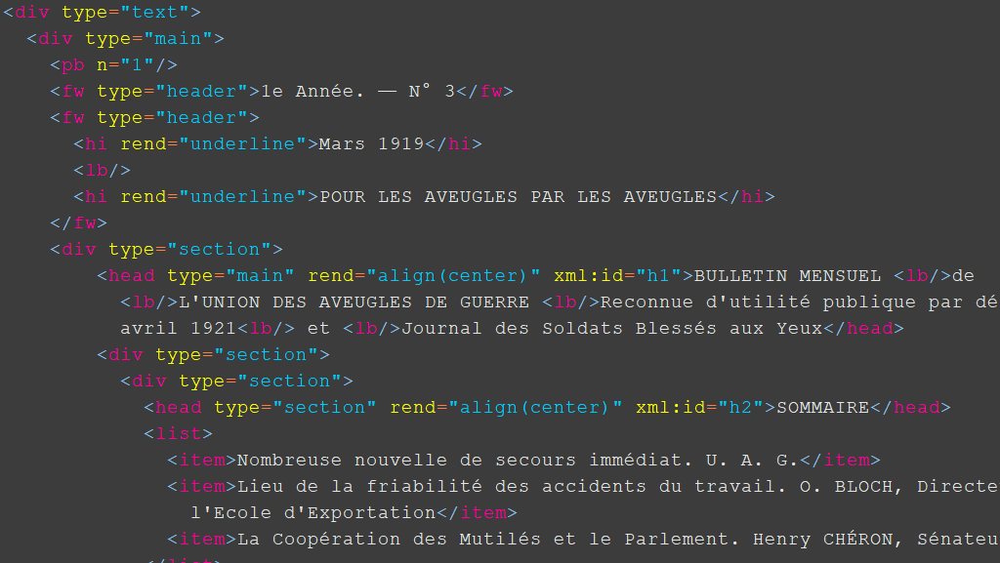

*La page de garde avant (gauche) et après (droite)*

Lors de l’encodage du document, les séparations de pages, marqués généralement en markdown par ‘\[Page 1\]’ ou ‘- 1 \-’, puis convertis en \<p\> en HTML, ont été enfin transformé en \<pb n=”X”/\>\<note type=”foliation”\>XX\</note\> en XML-TEI. Cela signifie que dans la structure des fichiers, lors de la conversion, les paragraphes coupés par une foliation étaient obligatoirement séparés et devenaient des \<p\> indépendants, d’un côté et de l’autre de la foliation. Afin de ne pas garder cette césure qui n’existe pas dans le document source, il est donc nécessaire de vérifier tous les cas de sauts de page, et d’enlever les balises fermantes et ouvrantes de \<p\> quand un paragraphe a clairement été coupé en plein milieu.

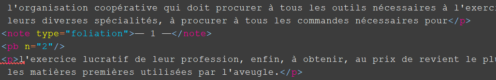
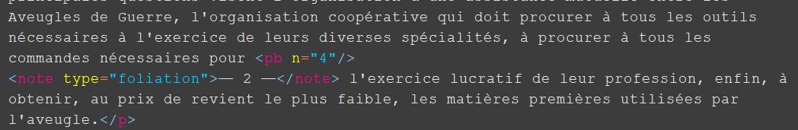 

*La séparation des paragraphes avec la foliation avant (haut) et après (bas)*

La comparaison avec le PDF est majoritairement nécessaire pour la mise en place de la foliation, et surtout la différence qu’il peut y avoir entre le numéro dans le @n de \<pb\> et la chaîne de caractères dans le \<note type=”foliation”\>. En effet, les revues contiennent, pour la majorité d’entre elles, une page de garde, ainsi qu’une liste de contributeurs (par exemple, Comité d’Honneur ou Liste de Donateurs), suivi du début officiel du bulletin, qui est considéré dans la pagination comme la première du document, ce qui signifie, fréquemment, que la page inscrite comme la deuxième dans la revue est comptée comme la quatrième dans le PDF. La mise en place de la foliation a été faite de manière à prendre cela en compte, afin que le comptage du \<pb\> commence à plus 2 à partir de la première marque de foliation trouvée.   
Cependant, cela ne fonctionne pas toujours ainsi, et il est donc parfois nécessaire d’opérer une correction de la correspondance de la foliation, pour que cela corresponde exactement au PDF qui est traité.

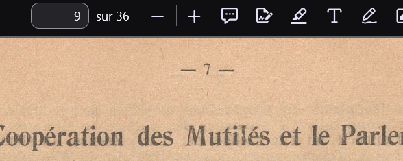

*La différence dans le PDF entre la foliation du PDF et la foliation de la revue*

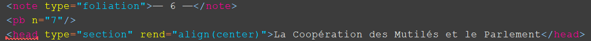
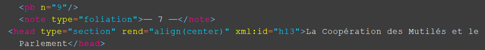

*La foliation du fichier XML avant (haut) et après (bas)*

Le script de conversion transforme les titres présents dans la structure markdown en titres de différents niveaux en HTML (\<h1\>, \<h2\>, \<h3\> et \<h4\>), et cette hiérarchie est ensuite utilisé pour convertir en titres XML TEI avec \<head\> et y ajouter un type=”section”, en fonction du niveau de titre HTML qui était présent à la base. Cependant, que ce soit à cause du processus d’océrisation qui a mal identifié un niveau de titre, ou l’encodage subséquent qui a mis le mauvais niveau de sectionnage, il est important de vérifier cela avec la structure de la revue disponible en PDF, et de corriger en conséquence. Il est effectivement essentiel d’avoir une hiérarchie correctement établie avant de passer à l’étape suivante, puisqu’une erreur pourrait fausser la table des matières.

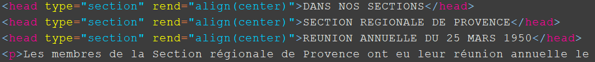
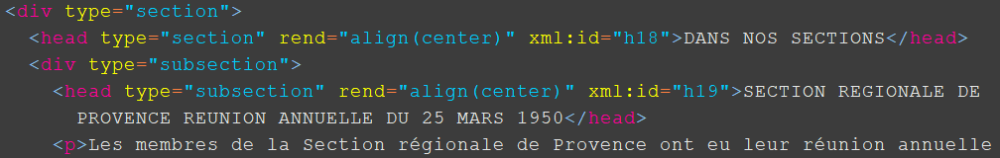

*Le sectionnage des \<div\> et des \<head\> avant (haut) et après (bas)*

Les revues du fonds contiennent un certain nombre d’en-tête et de pieds de pages, que cela soit les informations sur l’imprimeur en charge de l’édition, la mention répétée du titre de la revue ou encore des messages à faire passer par l’édition. Ces éléments apparaissent comme de simples bouts de texte et ils sont encodés avec la balise \<p\> sans aucun élément supplémentaire, ce qui ne correspond donc pas à leur vrai fonction. Une des fonctions du script create\_toc.py a pour but d’encoder quelques-uns de ces pieds de pages, en utilisant une expression régulière. Cependant, les informations ne sont pas toujours régulières, et les expressions régulières ne suffisent donc pas. Ainsi, il est nécessaire d’utiliser le document source PDF pour identifier ce qui est un en-tête ou un pied de page, et transformer la balise qui est utilisé pour l’entourer par la balise \<fw\> et possiblement ajouter le @type “header” ou “footer”.

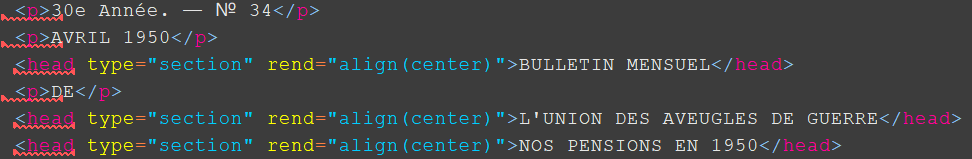
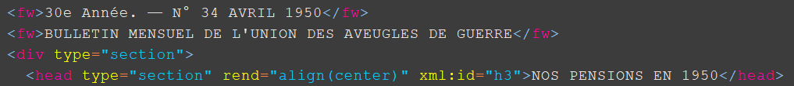

*Les en-têtes encodés avec \<fw\> avant (haut) et après (bas)*

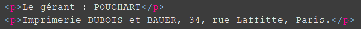
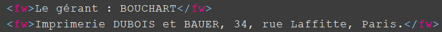 

*Les pieds de pages encodés avec \<fw\> avant (haut) et après (bas)*

Lors de l’océrisation des documents, la structure markdown a gardé les cas où l’outil a explicitement reconnu une liste ou une table, généralement car des éléments tels que des tirets, des astérisque ou de longs traits montraient clairement une structure. Dans ces cas-là, la conversion du markdown à la XML-TEI a conservé ces structures et a encodé le texte avec les balises \<list\> ou \<table\>. Cependant, dans certains cas, le document présente une liste continue de noms ou un tableau d’information, mais l’édition ne comprenant aucun signe particulier attestant de cela, l’encodage du texte est ressorti comme une succession de paragraphes \<p\> ou par un unique paragraphe contenant toute l’information en un bloc. Il est donc nécessaire pour parfaire la structure de l’encodage, mais également pour améliorer, en aval, la lecture du document, de rajouter les balises d’encodage pour les listes (\<list\>, \<head\>, \<item)\>) ou pour les tableaux (\<table\>, \<head\>, \<row\>, \<cell\>).

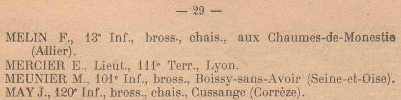
 

*Listes présentes sur les pages 29 et 30 d’un PDF*

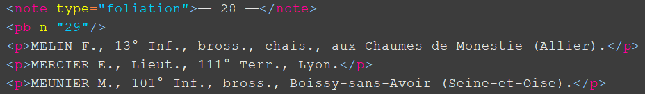
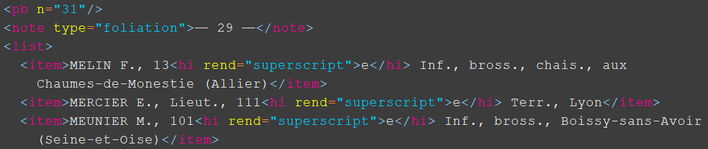

*Encodage propre d’une succession de \<p\> (haut) en une \<list\> TEI propre (bas)*

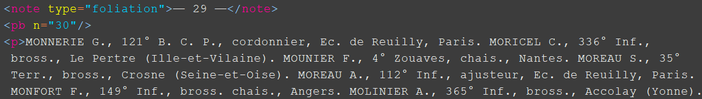
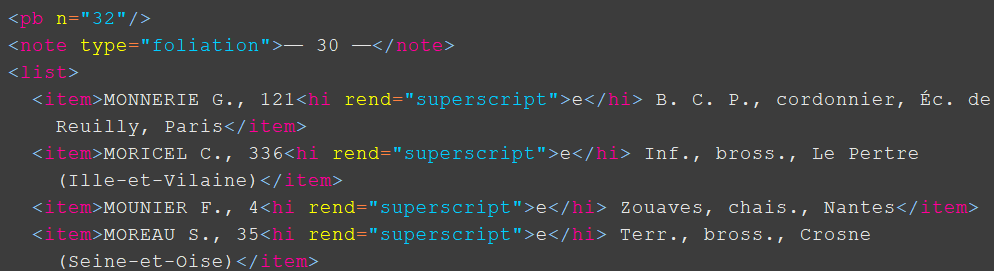  

*Encodage propre d’un \<p\> englobant le tout (haut) en une \<list\> TEI propre (bas)*

Enfin, le dernier pan de corrections qu’il est important de vérifier est l’encodage propre des éléments qui nécessitent un balisage pour permettre leur accessibilité par la suite. Il y notamment les éléments mathématiques, qui doivent être entourés d’une balise \<formula\> et de signes spécifiques comme \\times pour la multiplication, afin qu’il n’y ait pas de confusion avec la lettre x. Il y a les glyphes, comme l’obèle qui est marqué dans la revue devant les noms cités de personnes décédées, et qui doit être encodé avec une balise \<g rend=”obele”\> pour l’expliciter. Enfin, il y a les cas d’éléments en exposant, qui ne sont pas explicites à l’orale et qui doivent donc être encodés avec une balise \<hi rend=”superscript”\>.

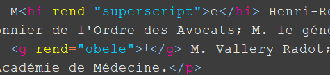
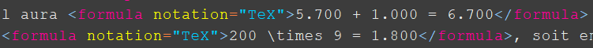

*Encodage des exposants, signes spéciaux (haut) et des signes mathématiques (bas)*

### 4. La deuxième étape de conversion : création de la TOC et dernières corrections 

Une fois les corrections faites sur les divers cas mentionnés précédemment, il est possible de passer à la deuxième étape de conversion, qui a pour but notamment d’ajouter les divisions englobantes \<div\> avec leur @type autour des blocs \<head\> et \<p\>, et ensuite, de créer une table des matières reprenant toute la hiérarchie qui aura été faite.   
La première étape est donc l’exécution du script *create\_toc.py*, avec comme dossier d’entrée, le dossier *tei/*, qui contient les fichiers XML-TEI créés lors de la première étape de conversion et qui viennent d’être corrigés, et comme dossier de sortie, le dossier *final/*. Cela permettra notamment de ne pas réécrire les fichiers, lors de la conversion, au cas où une erreur arrive.

```
python scripts/encoding_scripts/create_toc.py tei/ final/
```
*Ligne de commande à exécuter pour la création de la table des matières*

Une fois cette deuxième étape faite, il est nécessaire de passer à une nouvelle étape de relecture, qui a pour but de vérifier que l’englobement des divisions a été bien fait, et que le sectionnage, tel qu’il apparaît dans la revue, a bien été respecté. Une fois cela fait, l’étape suivante de correction consiste donc à vérifier la \<div type=”toc”\>, pour être sûr que l’imbrication des listes est bonne, et que les renvois entre @xml:id et @target sont corrects.  
Une fois cette vérification essentielle faite, il est possible de passer aux dernières corrections mineures, qui sont à la fois automatiques et manuelles. Parmi les erreurs que l’on peut encore avoir, il y a le cas des expressions régulières qui ont été mentionnées plus tôt, mais qui, comme on l’a dit, ne peuvent pas toujours absolument prendre en compte, et la lecture ligne par ligne serait bien trop longue. On utilise donc un script, *retrieve\_regex.py*, qui cherchent non seulement des expressions données, mais aussi les quelques signes que l’on peut fréquemment rencontrer lorsqu’il y a des éléments parasites tels que les accolades ({}), les crochets (\[\]), ou encore les doubles barres obliques inversées (\\\\). Si certaines sont trouvées, l’étape suivante consiste à ouvrir le fichier mentionné comme ayant l’élément et corriger directement l’élément. Une autre erreur récurrente que l’on peut avoir est la création de doubles \<div\> imbriqués, notamment dans la page de garde, puisque celle-ci était déjà parfaitement encodé, et donc, une nouvelle \<div\>, inutile, y a été ajoutée. Le script *replace\_div.py* a donc pour but d’éliminer ces doublons automatiquement. 

```
python scripts/retrieval_scripts/retrieve_regex.py final/ python scripts/modifying_scripts/replace_div.py final/
```
*Lignes à exécuter dans l’invite de commande pour les dernières corrections*

Parmi les modifications supplémentaires qui peuvent être faites, il y a en une qui est facultative, et qui dépend du contenu du dossier de départ lors du lancement du processus. Si le dossier *markdown/* contenait à la fois des markdown et des json, cette étape n’est pas nécessaire puisque les documents ont déjà toutes les métadonnées nécessaires. Cependant, si ce n’est pas le cas, l’exécution du script suivant permettra de pallier ce manque et d’ajouter les métadonnées manquantes, en s’appuyant sur un fichier JSON qui comprend les métadonnées pour tous les fichiers dont des éléments sont ajoutés. Les documents nouvellement modifiés par le script de suppression de \<div\> ont été placés dans un nouveau dossier, appelé *output/*. L’exécution du script facultative se fait donc à partir de ce dossier, avec une sortie dans le même dossier, signifiant donc que les documents sont réécrits directement.

```
python scripts/modifying_scripts/add_metadata_TEI.py index_json.json output/ output/
```
*Ligne facultative à exécuter dans l’invite de commande pour une correction supplémentaire*

La dernière étape de correction consiste à vérifier l'homogénéité des balises et attributs de l’encodage, et de vérifier qu’il n’y a pas eu d’erreurs faites dans les valeurs qui ont été mises. Pour contrôler cela, on exécute le script *retrieve\_tags\_attributes.py* pour connaître la structure générale de l’encodage des fichiers. La lecture du fichier de sortie permet de vérifier qu’aucune erreur a été commise, tels qu’ont pu être trouvé, pendant le processus, un “ection” au lieu de “section” pour le @type d’une \<div\>, ou un attribut de \<row\> avec @rend=”label” au lieu de @role=”label”. Pour corriger cela, il est possible d’utiliser à nouveau le script *retrieve\_regex.py* en ajoutant dans la liste de regex les éléments trouvés comme mal écrit pour savoir dans quels fichiers il est nécessaire de faire la modification. Afin d’être sûr d’avoir correctement corrigé toutes les erreurs et d’obtenir un fichier de données sur les balises, attributs, et valeurs, qui pourra être utilisé ultérieurement, il est important d’exécuter le script et de corriger les documents en conséquence jusqu’à ce que tout soit homogène.

```
python scripts/retrieval_scripts/retrieve_tags_attributes.py output/ teiHeader python scripts/retrieval_scripts/retrieve_tags_attributes.py output/ text
```
*Lignes à exécuter dans l’invite de commande pour récupérer les balises et leurs attributs*

Après avoir vérifié que toutes les erreurs mentionnées précédemment ont été bien vérifiés, les documents, placés actuellement dans un dossier *output/*, pourront être remis dans le dossier *final/*, avec un copié/collé qui réécrira donc les documents du dossier *final/* en les mettant à jour, avec leur dernière version complètement corrigée.

### 5. Le renommage explicite des fichiers

Maintenant que les documents du fonds “Aveugles de guerre” ont été soigneusement et correctement encodés en XML-TEI, la dernière étape consiste à renommer les fichiers pour qu’il soit plus facile de les identifier. Actuellement, les documents ont récupéré les noms de fichier qu’avaient les PDFs dont ils ont été transcrits. Ceux-ci ont été nommés en conformité avec l’identifiant qui leur ont été donnés pendant l’étape de catalogage réalisée par l’AVH. Ainsi, pour donner des exemples à partir des revues déjà traitées : 

- Le *bulletin de l’UAG et du Journal des Soldats Blessés aux Yeux* datant du mois d’octobre 1927 a comme nom de fichier “12261.xml”   
- La revue *Pour le Foyer du Soldat Aveugle* de l’année 1926 a comme nom de fichier “R1000005 \- 1926.xml”  
- La revue *Journal des Soldats Blessés aux Yeux* datant du mois de mai 1918 a comme nom de fichier “25741-1918\_05.xml”

Afin de procéder à ce renommage, le script *retrieve\_metadata.py* est utilisé, ce qui nous permet d’obtenir les informations sur le nom de fichier, son titre (et donc le nom de sa revue) et sa date, ce qui est collecté pour créer le nouveau du fichier, qui a la forme suivante, **nom\_de\_revue\_YYYY\_MM.xml**, et mettre en place les lignes de commande qui permettent de procéder à ce renommage.

```
python scripts/retrieval_scripts/retrieve_metadata.py final/
```
*Ligne à exécuter dans l’invite de commande pour obtenir des métadonnées*

Afin de ne pas complètement réécrire les fichiers, et de garder trace des fichiers d’origine qui ont été encodés, on crée un nouveau dossier, nommé *renamed/*, dans lequel on ajoute une copie de chacun des fichiers XML-TEI encodés. Ensuite, en suivant la méthode que l’on a déjà utilisée pour le renommage des fichiers JSON à l’étape 3.a), il est nécessaire de se placer dans le dossier *renamed/*, et d’exécuter ensuite la commande ‘mv’ suivi de l’ancien puis du nouveau nom du fichier (la concordance étant trouvé par le biais du CSV produit par *retrieve\_metadata.py*), ce qui va permettre de le renommer.

```
mv 12108.xml bulletin_uag_jsby_1920_04.xml 
mv 12133.xml bulletin_uag_jsby_1921_11.xml 
mv 12136.xml bulletin_uag_jsby_1921_12.xml 
mv 12134.xml bulletin_uag_jsby_1922_03.xml
```
*Exemple de lignes dans l’invite de commande pour le renommage des fichiers selon le nouveau*

Une fois que toutes les étapes mentionnées précédemment ont été effectués, et que l’on a maintenant ce qui peut être considéré comme la version finale des fichiers, on peut déposer le tout dans le dossier *faits/*, que cela soit les markdown (.md), les JSON (.json), ou les fichiers encodés, originaux ou renommés (.xml), afin de passer à une nouvelle salve d’encodage.