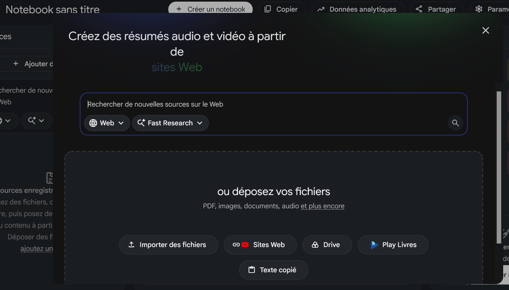
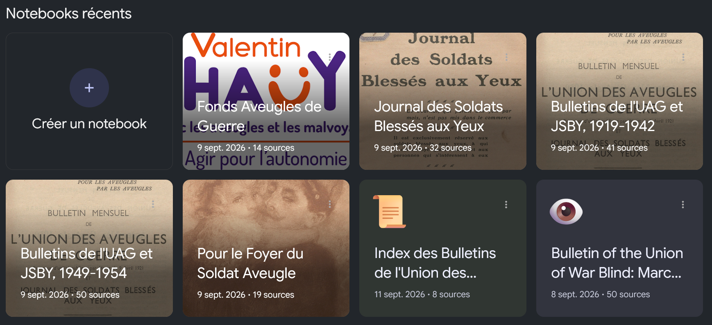
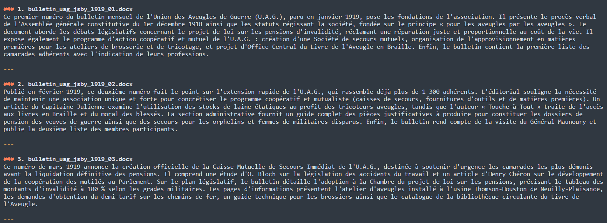
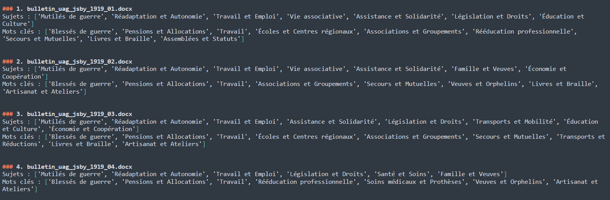
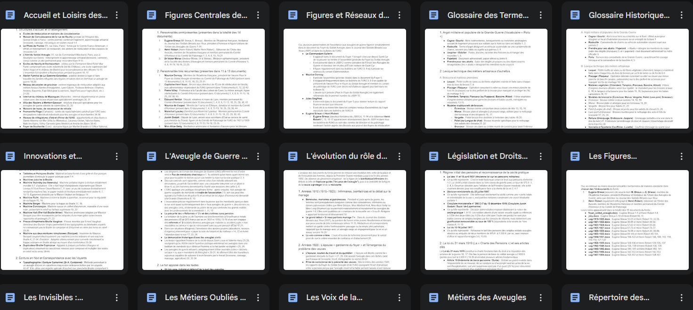

# Le processus d’exploitation des fonds sur Gemini Notebook

## 1. L’utilisation de Gemini Notebook

Gemini Notebook, anciennement appelé NotebookLLM, est une application web de recherche et de prise de note, qui s’appuie sur l’intelligence artificielle, en particulier Google Gemini, l’outil étant développé par Google Labs. Il s’utilise comme un “partenaire de recherche et de réflexion, basé sur les informations auxquelles vous faites confiance” ([https\://notebook.google/](https://notebook.google/)), et prend en source divers formats (PDF, sites web, docx, md, etc.), avec des réponses basés sur des sources directement cités, issus de ce qui aura été soumis dans le notebook. L’utilisation de l’outil se fait gratuitement, ce qui présente quelques limites : il n’est possible que de charger 50 documents dans un notebook, et chaque document ne peut être que de 200 Mo ou 500 000 mots maximum.   

*Page d’accueil de la création d’un nouveau notebook*

## 2. La transformation des fichiers XML-TEI en DOCX

Gemini Notebook supporte beaucoup de types de fichiers différents, mais il ne prend pas en charge les XML-TEI. Ainsi, afin de pouvoir exploiter correctement les fichiers, il est nécessaire de les transformer dans un format compatible, tout en gardant les modifications qui ont pu être faites lors de l’encodage. Le format choisi a été celui du DOCX, puisqu’il est déjà utilisé pour le Comité Éditorial Mixte (CEM).   
Dans le cadre de l’exploitation de Gemini Notebook, deux types de fichiers DOCX ont été créés : 

- une transformation directe, du type un fichier XML-TEI égale un fichier DOCX, ce qui sera utilisé pour récupérer des métadonnées sur ces fichiers  
- une transformation par lot de fichiers, entre deux à cinq, qui permet de respecter la limite des fichiers dans le notebook et de ne pas faire des fichiers trop lourds. 

Pour les créer, deux scripts Python ont été utilisés, *tei\_to\_docx\_single.py* et *tei\_to\_docx\_batch.py*, qui font essentiellement la même chose, à la différence de la sortie.

## 3. Les notebooks créés sur Gemini Notebook

Pour l’exploitation des documents et l’obtention d’informations, cinq notebooks ont été créés. Quatre contiennent les documents uniques, et sont répartis par type de revue : le *Journal des Soldats Blessés aux Yeux* (32 sources), *Pour le Foyer du Soldat Aveugle* (19 sources), le *Bulletin UAG JSBY*, 1919-1942 (41 sources) et le *Bulletin UAG JSBY*, 1949-1954 (50 sources), les deux derniers ayant été séparés en deux notebooks, pour une question de taille. Enfin, le dernier notebook, appelé, fonds Aveugles de Guerre, contient 14 sources, avec les lots de fichiers dedans.  

*Les notebooks créés avec les archives AVH*

## 4. Des requêtes pour récupérer des métadonnées

Afin d’obtenir certaines métadonnées qui étaient fournis dans le processus initial d’océrisation des fonds, par le biais de JSON fournis après génération par l’IA de Gemini et les données du catalogue Sharepoint, l’utilisation de Gemini Notebook a été mis en avant, utilisant ainsi la même IA que ce qui avait été utilisé auparavant et permettant de récupérer les résumés, les mots-clés et les sujets des documents sources.   
Les questions suivantes ont été posées de manière répété à tous les notebooks de revues de documents uniques : 

- Édites moi un fichier markdown dans Studio qui va contenir pour chacun des documents un résumé (assez général) du contenu du document en 5 à 10 lignes, avec le nom du fichier mentionné avec  
- Édites moi un fichier markdown dans Studio qui va contenir 5 à 10 mots clés et sujets pas trop spécifiques suivant le type suivant Sujets : \['Mutilés de guerre', 'Réadaptation et Autonomie', 'Travail et Emploi', 'Vie associative', 'Assistance et Solidarité', 'Législation et Droits'\] Mots clés : \['Blessés de guerre', 'Pensions et Allocations', 'Travail', 'Loisirs et Sports', 'Écoles et Centres régionaux', 'Associations et Groupements'\], avec le nom du fichier mentionné avec

 

*La sortie des résumés pour les bulletins UAG/JSBY*  

 

*La sortie des sujets/mots-clés pour les bulletins UAG/JSBY*

## 5. Des requêtes pour questionner le fonds

Afin de mettre en place l’annotation du fonds “Aveugles de guerre” et de répondre aux attentes du CEM, l’utilisation des Gemini Notebook a été mis en place, en posant des questions en lien avec les éléments que les membres du CEM veulent mettre en avant, tels que la reconnaissance de divers types de personnages (donateurs, soldats blessés, etc.), les types d’associations évoquées, les métiers anciens qui étaient pratiqués par des aveugles ou non, ou encore des termes obsolètes ou administratifs qui ne peuvent peut-être pas être compris par un public actuel. 

 

*Exemples des sorties données par Gemini Notebook*

## **Liste des requêtes faites dans le notebook “Fonds Aveugles de guerre” sur Gemini Notebook**

- Est-ce que tu trouves des noms de personnes qu'on retrouve au moins une fois dans chacun des documents ? → **Les Figures Récurrentes de l'Union des Aveugles de Guerre**  
- Est-ce que tu en as aussi qui sont au moins une fois dans foyer, jsby, et un des uag ? → **Figures et Réseaux de Soutien aux Aveugles de Guerre**  
- Peux-tu repérer au sein des diverses documents s’il y a des évolutions dans les évocations faites des femmes, ou si la récurrence se modifie d’une décennie à l’autre. → **L'évolution du rôle des femmes auprès des aveugles de guerre**  
- Peux-tu me sortir le nom de toutes les personnes qui ont fait un récit type écrit de soi avec "je" et si certains reviennent parfois → **Les Voix de la Reconstruction : Témoignages des Aveugles de Guerre**  
- Peux-tu me citer toutes les associations qui semblent être évoqués dans le document, avec si c'est fourni l'adresse, les documents où cela apparaît et les différentes formes qui peuvent exister du nom de l'association → **Répertoire des Associations d’Aveugles et Victimes de Guerre**  
- Je veux que tu me sortes une liste de noms recensant toutes les personnes qui sont mentionnés dans plus de 10 documents en même temps (ne compte que si minimum une fois par document) → **Figures Centrales de l'Union des Aveugles de Guerre**  
- Je voudrais maintenant plutôt des noms de quidams qui ne figurent pas dans ces listes si tu en trouves des récurrents → **Les Invisibles : Portraits des Fidèles Soutiens aux Aveugles de Guerre**  
- Est-ce que tu peux me donner la liste des métiers mentionnés quand ils sont plutôt inconnus de nos jours et expliqués (tels brossier ou autre) dans le document (avec la définition qui en est donnée) et pas s'ils sont juste mentionnés comme métier d'une personne dans une liste ? → **Les Métiers Oubliés et Techniques de Rééducation Artisanale**  
- Peux-tu me sortir une liste de mots qui semblent dépassés, obsolètes et/ou méconnus et qui aurait besoin d'être explicité dans un glossaire ? → **Glossaire des Termes Militaires et Techniques d'Antan**  
- Peux-tu développer un peu plus pour chacune des catégories que tu as proposé, si tu penses qu'il y en a d'autres qui méritent plus d'explications ? → **Glossaire Historique des Métiers et de l'Invalidité de Guerre**  
- Maintenant, je veux que tu me sortes tous les cas où on parle d'une certaine loi, d'un décret, article, décision administrative ou autre, en lien avec le cas ou statut d'aveugle de guerre et ce que cela représente si c'est dit dans le texte → **Législation et Droits des Aveugles de Guerre (1831-1954)**  
- Peux-tu me sortir toutes les mentions de lieux ou institutions externes (hors France) citées dans les documents ? → **Solidarité Internationale pour les Aveugles de Guerre**  
- Fais moi la liste des TECHNOLOGIES D’ASSISTANCE et/ou OUTILS TECHNIQUES DE RÉADAPTATION qui sont mentionnés dans le texte (avec leur variante et évolution s'il y en a) et toute information supplémentaire qui serait mentionné dans les documents → **Innovations et Technologies d’Assistance pour Aveugles de Guerre**  
- Fais moi la liste des STRUCTURES D’ACCUEIL ou des LOISIRS qui ont été mis en place pour les aveugles de guerre → **Accueil et Loisirs des Aveugles de Guerre**  
- Peux-tu me citer des cas où on mentionne l'aveugle de guerre avec l'idée d'assistance ou de mendicité, le ton qui y est apposé, et la récurrence du thème ? → L'Aveugle de Guerre : Entre Dette Nationale et Dignité”  
- Peux-tu me lister TOUS les lieux qui sont mentionnés plus de 10 fois dans les documents, en mettant la liste des fichiers dans lesquels ils apparaissent ? → **Topographie des Aveugles de Guerre**  
- Fais moi la liste de ABSOLUMENT TOUS les métiers mentionnés dans les documents (excepté ce que l'on trouve dans les listes de gens) et donne moi les explications de ce que cela est quand c'est donné → **Répertoire des Métiers**  
- Maintenant, parmi tous les métiers que tu m'as cité, lesquels, selon les documents, ont été, sont ou pourront être exercés par des aveugles et/ou des malvoyants ? → **Métiers des Aveugles**  
- Peux-tu me citer tous les types d'aveugles et malvoyants qui sont mentionnés dans les documents ? → **Typologie des aveugles de guerre**  
- Pourrais-tu me faire le récit de l'évolution des conseils et comités (administration, d'honneur, etc) avec les personnes dedans, la hiérarchie, etc. ? → **Gouvernance des Aveugles**  
- Peux-tu me sortir des cas des personnalités assez spéciales tel qu'un aveugle élu député, ou des choses assez exceptionnelles de ce style ? → **Figures Illustres**  
- Pour les index de personnes que tu m'as donné ou tu m'as mentionné s'ils étaient aveugles ou non, comment as-tu su s'ils sont aveugles, est-ce que cela doit être dit explicitement ou tu prends les commentaires implicites aussi ? → **Statuts et identités**
