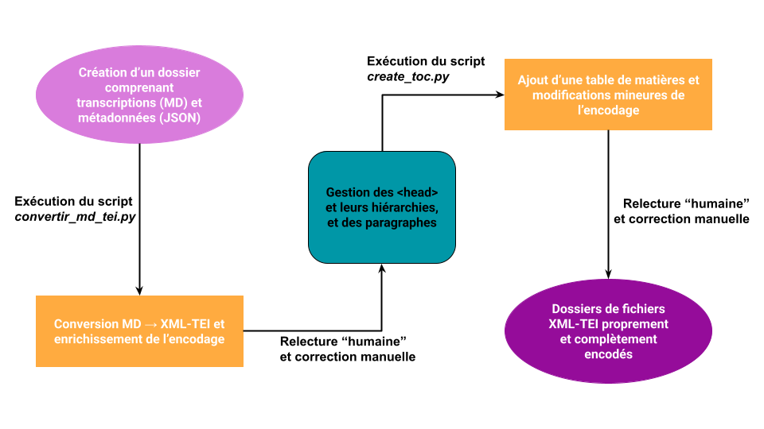

# Conversion TEI/XML — Documentation

Ce projet transforme des fichiers Markdown en **XML TEI complet**, enrichi par :

* des métadonnées provenant d’un JSON combinant SharePoint et un modèle IA ;
* un encodage structuré respectant les recommandations TEI ;
* la génération d’une table des matières hiérarchique et des corrections structurelles ;
* une cohérence éditoriale complète via des variables et règles prédéfinies.

L’objectif est de produire des fichiers TEI prêts pour l’édition numérique, l’indexation ou la diffusion patrimoniale.

---

## 1. Architecture générale

Le projet s’articule autour de trois blocs principaux :

1. **Conversion Markdown → TEI (`md_to_tei`)**

   * Transforme le Markdown en HTML (`markdown_to_html`) puis en TEI.
   * Crée un squelette TEI avec `<teiHeader>`, `<fileDesc>`, `<encodingDesc>`, `<profileDesc>`, `<text>`.
   * Encode automatiquement le contenu textuel et les marqueurs `[Page X]`.

2. **Injection de métadonnées (`inject_metadata`)**

   * Remplit `titleStmt`, `publicationStmt`, `profileDesc`, `seriesStmt`, `textClass`, `msDesc` à partir d’un JSON.
   * Gère les champs uniques ou multiples, les valeurs absentes et normalise les identifiants via `slugify`.
   * Champs pris en charge : type de document, mots-clés, sujets, titre principal, auteur/éditeur, résumés, classification Dewey, date, format et droits.

3. **Post-traitement TEI (`process_tei`)**

   * Regroupe les titres hiérarchiquement (`group_all_heads`) et normalise les dates (`normalize_dates`).
   * Transforme le contenu de bas de page (`transform_footer_info`).
   * Génère une table des matières hiérarchique (`build_hierarchical_toc`).
   * Ajoute une entrée de révision automatique.

---

## 2. Fonctionnement batch

* `batch_process_md(dossier_md, dossier_tei)` : convertit tous les fichiers Markdown d’un dossier en TEI.
* `batch_process_tei(input_dir, output_dir)` : applique le post-traitement sur un dossier complet de fichiers TEI.

---

## 3. Dépendances et modules

### 3.1 Bibliothèques standard

* `json` pour charger les métadonnées
* `os` pour la gestion des dossiers
* `re` pour détecter des signatures structurelles
* `sys` pour arguments CLI
* `datetime.date` pour la datation automatique des révisions

### 3.2 Parsing et création XML

* `BeautifulSoup` : parse l’HTML intermédiaire issu du Markdown
* `lxml.etree` : crée et sérialise le TEI XML

### 3.3 Variables éditoriales (`variables.py`)

Fournissent automatiquement :

* la description du projet et les autorités responsables
* les responsables de numérisation, transcription et encodage
* les informations sur la collection et le manuscrit (`msDesc`)
* les règles éditoriales (césure, guillemets)

Ces variables assurent une cohérence éditoriale sur tous les fichiers générés.

### 3.4 Fonctions utilitaires (`functions.py`)

| Fonction                 | Rôle                                             |
| ------------------------ | ------------------------------------------------ |
| `markdown_to_html`       | Convertit Markdown → HTML                        |
| `clean_text`             | Nettoie le texte avant encodage                  |
| `slugify`                | Normalise une chaîne pour identifiants           |
| `text_enrichment`        | Applique des enrichissements personnalisés       |
| `list_encoding`          | Encode les listes selon les conventions TEI      |
| `encode_elements`        | Transforme les éléments HTML en TEI              |
| `insert_foliation`       | Ajoute automatiquement les repères de page       |
| `normalize_dates`        | Harmonise les formats de dates et attributs      |
| `build_hierarchical_toc` | Génère une table des matières complète           |
| `group_all_heads`        | Regroupe logiquement les titres (`<head>`)       |
| `transform_footer_info`  | Convertit les informations de bas de page en TEI |

### 3.5 Métadonnées JSON (`metadata_json.py`)

* `inject_metadata(metadata, titleStmt, publicationStmt, profileDesc, seriesStmt, textClass, msDesc, slugify)`
* Complète automatiquement les sections TEI selon les règles éditoriales et normalise les identifiants.

---

## 4. Workflow résumé

1. **Conversion Markdown → TEI** avec `md_to_tei`.
2. **Injection des métadonnées** via `inject_metadata`.
3. **Post-traitement** avec `process_tei` pour structure, dates, pieds de page et TOC.
4. **Export** du fichier TEI final (`UTF-8`, XML declaration, pretty print).
5. **Batch processing** possible pour des dossiers complets.

---

